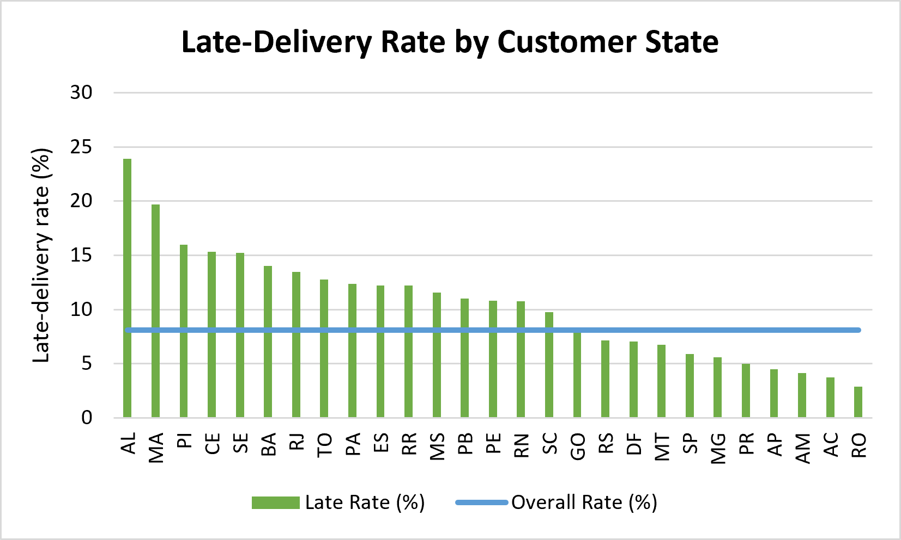
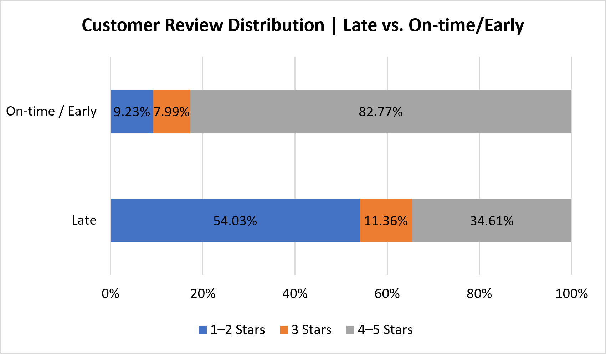
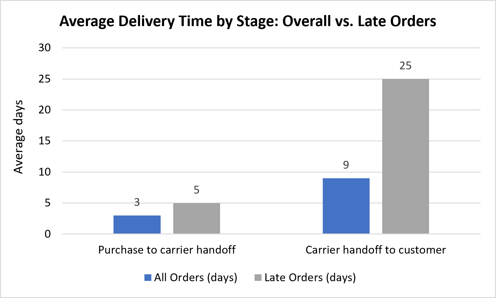

# Olist Marketplace Analysis | SQL Server

An end-to-end SQL analysis of the Brazilian E-Commerce Public Dataset by Olist, covering approximately **99,000 orders** from September 2016 to October 2018.

The project investigates delivery performance, its association with customer reviews, geographic differences in late deliveries, and six-month customer retention.

## Key Findings

1. **Late delivery:** 7,826 delivered orders (8.11%) arrived after the estimated delivery date, representing R$1.35M in associated payment value—not necessarily lost revenue.
2. **Customer reviews:** 54.03% of reviewed late orders received 1–2 stars, compared with 9.23% of on-time or early orders.
3. **Delivery delays:** Late orders averaged 25 days from carrier handoff to customer, compared with 9 days for all orders.
4. **Geographic differences:** Rio de Janeiro (RJ) had a 13.47% late-delivery rate, compared with 5.89% in São Paulo (SP).
5. **Customer retention:** Six-month retention was 2.69%. Retention was 2.39% for customers whose first delivered order was late and 2.72% for those whose first order was on time or early.

## Visualizations

### Late-Delivery Rate by Customer State

### Customer Review Distribution

### Average Delivery Time by Stage

## Tools & SQL Techniques

- **Database:** Microsoft SQL Server
- **Environment:** SQL Server Management Studio (SSMS)
- **SQL:** CTEs, joins, subqueries, window functions (`ROW_NUMBER`, `LAG`), conditional aggregation, `EXISTS`, date functions, and percentile analysis
- **Analysis:** Delivery performance, review-score comparisons, geographic analysis, and customer-retention cohorts

## Project Files

- [**Read the SQL Case Study (PDF)**](Olist-Marketplace-SQL-Case-Study.pdf) — Business problem, methodology, visualizations, findings, recommendations, and limitations.
- [**Schema and Setup Queries**](SQL%20OLIST%20tables%20schema%20query.sql) — Table schemas and setup queries.
- [**Main SQL Analysis**](SQL%20project%20OLIST%20main%20query.sql) — Analysis queries and conclusions.

## Recommendations

- Track late-delivery rates against estimated delivery dates, alongside median and 90th-percentile delays.
- Investigate the carrier-to-customer stage, where late orders take substantially longer.
- Review delivery performance and estimated-date accuracy for Rio de Janeiro.
- Investigate customer retention separately rather than assuming delivery delays explain low repeat purchasing.

## Limitations

- Delivery and review patterns indicate associations, not causation.
- Payment value associated with late orders represents exposure, not confirmed lost revenue.
- Marketing, shipping, and fulfilment costs are not fully represented in the analysis.
- Retention results apply to the defined six-month cohort.

**Dataset:** [Brazilian E-Commerce Public Dataset by Olist — Kaggle](https://www.kaggle.com/datasets/olistbr/brazilian-ecommerce)

**Built by Kritika Sharma**
Indore, India | [LinkedIn](https://www.linkedin.com/in/kritika-sharma-a72199235/)
